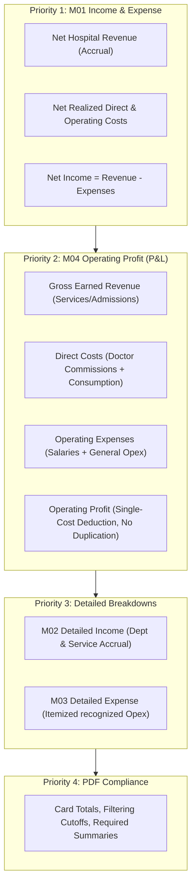

# HMS — STRICT REPORTING-ONLY SCOPE LOCK

**Project:** CH Sharif & Saeed Hospital — Hospital Management System (HMS)  
**Authoritative Reference:** `HMS Final Reporting.pdf` (18 November 2026, 6 Pages)  
**Current Execution State:** Batch 1 Active & Running — **DO NOT RESTART**  
**Policy Status:** STRICT SCOPE LOCK APPLIED (Reporting Layer Only)

---

## 1. Executive Mandate & Purpose

This document establishes the binding architectural and functional boundary for **HMS Financial & Management Reporting (Batch 1)**.

1. **Existing Operational HMS is Approved:** All operational workflows, database models, Prisma schema, front-desk interactions, admission lifecycles, and core business rules are approved and must remain strictly intact.
2. **Strictly Reporting-Only:** All modifications are restricted solely to the reporting query/calculation layer. No transaction posting, operational service logic, billing lifecycle, or inventory issue mechanics may be altered.
3. **Reference Standard:** Every calculation and field must conform strictly to `HMS Final Reporting.pdf`.

---

## 2. Invariance & Non-Destructive Guarantees

The following operational subsystems and workflows are **STRICTLY LOCKED** and must not be modified:

| Subsystem | Invariant Workflow Rules |
| :--- | :--- |
| **OPD & Front Desk** | Patient registration, doctor visit queues, token numbering, consultation fee collection, and discount authorizations remain unchanged. |
| **Inpatient & Admission** | Admission records, admission charges, bed assignments, transfers, room day calculations, and discharge dual-clearance workflows remain untouched. |
| **Billing & Payments** | Invoice generation, installment payments, receipt issuance, allocation logic, and credit handling remain unchanged. |
| **Doctor Commissions** | Commission slabs, department attribution rules, doctor payout profiles, and historical payout ledgers are untouched. |
| **Cash Settlement & Vault** | Shift reconciliation, physical cash declaration, variance computation, handover routing, and Main Cash Fund reserve entries remain unchanged. |
| **General Inventory** | Stock item definitions, GRN reception, FEFO stock ledgers, and department issue workflows remain intact. |
| **Pharmacy Separation** | Standalone Pharmacy ERP workflows, medicine stock, dispensing, sales, and bridge queues remain completely isolated. |

> [!IMPORTANT]
> **Strict Architecture Boundary:**
> - DO NOT introduce new financial engines or synthetic ledgers.
> - DO NOT modify Prisma schema (`schema.prisma`) or execute database migrations.
> - DO NOT silently rewrite posted financial history.
> - DO NOT redesign UI layout, themes, or non-reporting application components.

---

## 3. Priority Focus for Batch 1

Batch 1 focuses exclusively on confirmed discrepancies in the management financial reporting layer:

### Priority 1: Income & Expense (M01)
- **Accrual Revenue Recognition:** Recognized when service/admission charge is earned (excluding tax), independent of partial or cross-month installment receipt timing.
- **Collection vs. Revenue Segregation:** Cashier receipt collections are custody movements, not duplicated earned income.
- **Expense Alignment:** Reflects recognized operational expenses minus authorized expense reversals.

### Priority 2: Operating Profit (M04 / P&L)
- **Mathematical Formula:**
  $$\text{Operating Profit} = \text{Net Earned Hospital Revenue} - \text{Direct Service Costs} - \text{Recognized OPEX} - \text{Staff Payroll \& Doctor Commissions}$$
- **Zero Double-Deduction:** Consumable costs, doctor commission payouts, and staff salaries must be subtracted exactly once. An aggregate expense category must never be subtracted alongside its constituent line items.
- **Capital & Non-Expense Exclusion:** Inventory asset purchases, supplier balance repayments, and internal drawer cash handovers are never treated as operating expenses.

### Priority 3: Detailed Income (M02) & Detailed Expense (M03)
- **M02 Detailed Income:** Departmental attribution (OPD, Emergency, Observation, Inpatient, Diagnostics, Procedures) based on gross earned amounts, approved discounts, and net accrued revenue.
- **M03 Detailed Expense:** Comprehensive categorization of operational costs (Utilities, Maintenance, Clinical Consumables, Admin, Depreciation/Rent if applicable) matching canonical expense vouchers.

### Priority 4: Mandatory Missing Fields & Totals
- Align all KPI summary cards, table columns, date range filter presets (`today`, `yesterday`, `this_week`, `this_month`, `custom`), and exportable totals strictly with `HMS Final Reporting.pdf` pages 1–6.

---

## 4. Change Escalation & Exception Protocol

If resolving a reporting discrepancy appears to require modifying operational business rules or changing transaction lifecycle behaviors:

1. **HALT:** Immediately stop that specific code change.
2. **DOCUMENT:** Note the exact conflict between the reporting PDF requirement and the current operational logic.
3. **REPORT:** Present the discrepancy to the User/Stakeholders for explicit policy approval.
4. **NO ASSUMPTIONS:** Never silently alter an operational business rule to make a report pass.

---

## 5. Execution Rules & Verification Protocol

1. **Minimal Reporting-Layer Diffs:** Implement changes exclusively in `managementReports.service.ts`, reporting DTO schemas, and corresponding UI reporting views.
2. **Calculation Integrity:** Reconcile all formulas against verified database fixtures and cross-validate with zero tolerance for floating-point drift (using `Prisma.Decimal`).
3. **Typecheck & Linting Guard:**
   - Backend: `npm --prefix "HMS Software\backend" run typecheck` (`tsc --noEmit`) must exit with code `0`.
   - Frontend: `npm --prefix "HMS Software\frontend" run lint` (`tsc --noEmit`) must exit with code `0`.
4. **Post-Batch Action:** Once Batch 1 financial reports are verified, **STOP** execution and deliver a concise, factual verification summary.
