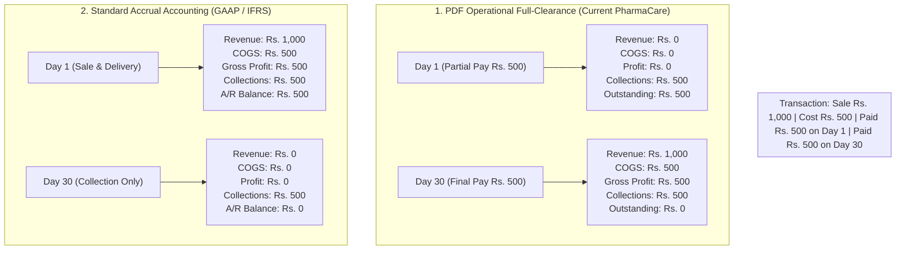

# PHARMACY ERP — COMPLETE FINANCIAL FORMULA & REPORTING AUDIT
## Phase 1: Comprehensive READ-ONLY Analysis & Mathematical Trace

**Project:** CH Sharif and Saeed Hospital — Standalone Pharmacy Management System (PharmaCare ERP)  
**Audit Mode:** STRICTLY READ-ONLY (No code, database or configuration modifications performed)  
**Date of Audit:** November 19, 2026  
**Authoritative Reference:** `Pharmacy Final Reporting.pdf` (all 4 pages, dated 18 Nov 2026) & Latest Pharmacy Codebase  
**Status:** Audit Completed — Awaiting User Policy Approvals Before Implementation

---

## Section A — Executive Summary

A comprehensive, end-to-end mathematical and code audit of the latest Pharmacy ERP was performed across the financial recognition engine (`financialRecognition.ts`), statement generators (`operatingProfit.ts`, `incomeExpense.ts`), report dispatchers (`reports.service.ts`), cashier balances (`cash.service.ts`), invoice handlers (`pharmacy.service.ts`), and frontend consumers (`ReportView.tsx`).

### Quantitative Audit Summary:

| Category | Total Count | Confirmed Correct (PASS) | Confirmed Defective (FAIL) | Partial / Contract Gap | Blocked by Policy Decision |
|:---|:---:|:---:|:---:|:---:|:---:|
| **Management Reports (M01–M10)** | 10 | 1 | 4 | 5 | 0 |
| **Sales / Cashier Views (S1–S5)** | 5 | 1 | 2 | 2 | 0 |
| **Individual Mathematical Formulas** | 18 | 13 (72.2%) | 5 (27.8%) | 0 | 0 |
| **API / Frontend Data Contracts** | 10 | 4 | 6 | 0 | 0 |
| **Core Accounting Policy Points** | 5 | 2 | 0 | 0 | 3 (Awaiting Decision) |

### Key Diagnostic Findings:
1. **The Core Financial Engine is ~75% Sound:** The event-driven projection loop (`projectInvoice`) correctly applies decimal arithmetic, preserves tax separation from revenue, defers revenue during partial payments, and excludes vendor settlements from operating expenses.
2. **Four Critical Financial Calculation Bugs Confirmed:**
   - **Missing-Cost Profit Override:** When an invoice lacks historical batch cost, `financialReport` correctly marks `operatingProfit = null`, but `operatingProfit.ts` overrides it with a synthetic profit calculation, falsely displaying high profit.
   - **Stock Losses Absent from P&L:** Operating Profit and Income & Expense omit stock adjustments/write-offs from the P&L deduction, inflating bottom-line profits.
   - **Purchase Inward Inflated by Drafts:** Report M05 queries `where: { purchaseDate: range }` without filtering `status: 'POSTED'`, treating uncommitted draft purchase orders as received inventory.
   - **Returns/Refunds Value Cancellation:** In M09, positive customer refunds and negative vendor return credits are added together, cancelling each other out into a misleading net total.
3. **Historical Candidate Query Flaw:** In `loadFinancialData()`, filtering by `status: { not: 'PAID' }` causes invoices that were unpaid at historical cutoffs (e.g. October 31) but paid later (e.g. November) to vanish from historical outstanding receivables.
4. **Sales/Cashier Authorization Gap:** The API role `SALES_DISPENSING` is granted global `reports:view` without server-side type filtering, permitting cashiers to query company-wide Operating Profit, Income & Expense, and Vendor Payables.

---

## Section B — Formula Verification Matrix

| Report / View ID | Exact Title | Actual Source File & Function | Current Implemented Formula | PDF Specification Formula | Numeric Expected vs Actual | Status | Severity |
|:---|:---|:---|:---|:---|:---|:---:|:---:|
| **M01** | Income & Expense | `incomeExpense.ts:5`, `financialRecognition.ts:340` | `GP = Rev - COGS`; `OP = GP - Opex` | `OP = Rev - COGS - Opex - Stock Losses` | Sale 1000, Cost 600, Opex 150, Loss 50 $\rightarrow$ Expected: **200**; Actual: **250** | **PARTIAL** | High |
| **M02** | Operating Profit | `operatingProfit.ts:66, 232` | `GP = Rev - COGS`; `OP = GP - Opex` (overwrites null) | `OP = Rev - COGS - Opex - Stock Losses` (strict null guard) | Missing Cost Sale 1000 $\rightarrow$ Expected: **null / Incomplete**; Actual: **850 (inflated)** | **FAIL** | **P1 (Blocker)** |
| **M03** | Detailed Income | `financialRecognition.ts:231`, `reports.service.ts:38` | `Due(t) = Net Inv - Paid(t)`; `Rev = Total (once fully paid)` | Same. One row per invoice with installment timeline | Installments 500/200/300 $\rightarrow$ Expected: Dues 500/300/0, Rev 1000 on Pay 3. Actual: **Matches** | **PASS (Math)** / Partial (UI) | Medium |
| **M04** | HMS Request / Dispense | `reports.service.ts:59` | Text summary of requested vs dispensed; invoice totals | `Fulfillment % = Dispensed / Requested * 100` | 10 req, 6 disp $\rightarrow$ Text only; lacks separate batch, expiry & numeric % columns | **PARTIAL** | Medium |
| **M05** | Purchase Inward | `reports.service.ts:90` | `SUM(total)` for all purchases including `DRAFT` | `Net Acquired = Posted Purchases - Purchase Returns` | Posted 5000, Draft 3000 $\rightarrow$ Expected: **5,000**; Actual: **8,000** | **FAIL** | **P1 (Blocker)** |
| **M06** | Stock Movement Audit | `reports.service.ts:124`, `pharmacy.service.ts:98` | List of `stockLedgerEntries` with signed delta | `Closing = Opening + IN - OUT +/- Adj`; Issued Cost = `Qty * UnitCost` | Keys mismatch (`batchNumber` vs `batch`); valuation and closing balance absent | **PARTIAL** | Medium |
| **M07** | Vendor Payables Ledger | `reports.service.ts:147` | Global sum of signed amounts in date window | `Closing = Opening + Purchases - Payments - Returns +/- Adj` | Opening 1000, Pur 6000, Pay 2500, Ret 500 $\rightarrow$ Expected: **4,000**; Actual: **Flat signed sum (no opening)** | **FAIL** | **P1 (Blocker)** |
| **M08** | Detailed Expense | `reports.service.ts:173`, `expenses.service.ts:10` | `SUM(amount)` for all expenses in range | `Net Opex = Valid Expenses - Reversals` (approved opex only) | Unapproved expenses included; voucher/account references missing | **PARTIAL** | Low |
| **M09** | Sales & Purchase Returns | `reports.service.ts:201` | `Total = Sales Refunds (+) + Vendor Return Credits (-)` | Separate Sales Refund total and Vendor Credit total | Refund 500, Vendor Credit -500 $\rightarrow$ Expected: **500 Ref / 500 Cred**; Actual: **0 (cancelled)** | **FAIL** | **P1 (Blocker)** |
| **M10** | Balance & Drawer Settlement | `reports.service.ts:295`, `cash.service.ts:113` | Shift expected cash vs counted physical cash | `Pre = Opening + In - Out`; `Post = Pre - Accepted Out + Accepted In` | Variance calculated correctly; partial acceptance and receiver custody missing | **PARTIAL** | Medium |
| **S1** | My Sales Invoices | `pharmacy.controller.ts:85`, `pharmacy.service.ts:1663` | Company-wide `/pharmacy/invoices` without userId filter | Own authorized POS invoices only | Cashier B can query Cashier A's invoices via API | **FAIL** | **P1 (Security)** |
| **S2** | Prescriptions Queue | `hms-requests.controller.ts:42` | Filter by `status` only; no user assignment filter | Assigned requests only | Shared queue accessible by all cashiers | **PARTIAL** | Medium |
| **S3** | My Balance Sheet | `cash.controller.ts:14`, `balanceSheet.util.ts:3` | User-filtered physical cash ledger entries | `Opening + Own Cash In - Own Cash Out - Accepted Handover` | Expected vs Physical calculated strictly per user session | **PASS** | Low |
| **S4** | My Settlement | `cash.controller.ts:28`, `cash.service.ts:170` | Query passes optional `userId`; missing mandatory filter | Own submitted settlements only | Cashier can view all staff settlements via API | **FAIL** | **P1 (Security)** |
| **S5** | My Shift Reports | `ReportView.tsx:316` via `reports-sales` route | Points to company-wide Detailed Income report | Own shift collections, payments, refunds and cash drawer | Cashier sees hospital-wide company revenues | **FAIL** | **P1 (Security)** |

---

## Section C — Confirmed Formula & Engine Bugs

### Bug 1: Operating Profit Overwrites Missing-Cost Incompleteness Guard
- **Location:** `Pharmacy Software/backend/src/modules/reports/operatingProfit.ts`, Lines 64–66 & 232.
- **Current Defective Code:**
  ```typescript
  // operatingProfit.ts
  const grossProfit = recognizedRevenue.minus(medicineCogs);
  const operatingExpenses = totals.operatingExpenses;
  const operatingProfit = grossProfit.minus(operatingExpenses);
  ...
  const totalsObj = {
    ...totals,
    grossProfit,
    operatingProfit, // Overwrites totals.operatingProfit (which was null)
  };
  ```
- **Independent Expected Behavior:** In `financialRecognition.ts:360`, the canonical engine sets `operatingProfit = null` whenever `incompleteInvoices > 0` (e.g. an invoice has missing batch acquisition cost). `operatingProfit.ts` must honor this null guard instead of subtracting 0 COGS and reporting an inflated profit.
- **Synthetic Test Reproduction:**
  Invoice: 1,000 PKR fully paid, but line `costRateSnapshot` is null.
  - Canonical `financialReport`: `totals.operatingProfit = null`.
  - `operatingProfitReport`: reports `operatingProfit = 1,000 - 0 - Opex = 850 PKR` (False Positive).
- **Root Cause:** Manual re-calculation in `operatingProfit.ts` ignores the `incomplete` flag.
- **Financial Impact:** Severe overstatement of pharmacy profitability when legacy or uncosted batches are sold.
- **Minimal Correction:**
  ```typescript
  const operatingProfit = totals.incompleteInvoices > 0 ? null : grossProfit.minus(operatingExpenses);
  const grossProfitGuarded = totals.incompleteInvoices > 0 ? null : grossProfit;
  ```

---

### Bug 2: Stock Losses / Adjustments Omitted from P&L Deductions
- **Location:** `Pharmacy Software/backend/src/modules/reports/financialRecognition.ts`, Line 279 & `operatingProfit.ts`, Line 66.
- **Current Defective Code:**
  `loadFinancialData()` queries `pharmacyInvoice`, `cashLedgerEntry` (refunds), and `expense`. It does NOT query `stockAdjustment` or negative stock write-offs.
  `operatingProfit = grossProfit.minus(operatingExpenses);`
- **Independent Expected Behavior (PDF p2):**
  $$\text{Operating Profit} = \text{Recognized Revenue} - \text{COGS} - \text{Operating Expenses} - \mathbf{\text{Stock Losses}}$$
- **Root Cause:** Stock damage, expiry write-offs, and negative adjustments recorded in `stock_adjustments` are never loaded into the financial engine.
- **Financial Impact:** Damaged or expired inventory write-offs are hidden from the P&L, overstating net operating income.
- **Minimal Correction:**
  Query `stockAdjustment` with valuation (`quantity * costRate`) for the date range, aggregate `stockLosses`, and subtract from Operating Profit.

---

### Bug 3: Purchase Inward Report Includes Unposted DRAFT Purchases
- **Location:** `Pharmacy Software/backend/src/modules/reports/reports.service.ts`, Lines 93 & 99.
- **Current Defective Code:**
  ```typescript
  // reports.service.ts - purchase()
  prisma.purchase.findMany({ where: { purchaseDate: range }, ... })
  prisma.purchase.aggregate({ where: { purchaseDate: range }, _sum: { total: true, ... } })
  ```
- **Independent Expected Behavior:** Only `POSTED` purchases represent actual received stock and liabilities. Unapproved/unreceived `DRAFT` purchases must be excluded from goods-inward totals.
- **Synthetic Test Reproduction:**
  - Create 1 Posted Purchase: Rs. 5,000.
  - Create 1 Draft Purchase Order: Rs. 3,000.
  - Purchase Inward report displays: **Total Value = Rs. 8,000** (Overstated by Rs. 3,000).
- **Root Cause:** Missing `status: 'POSTED'` filter in Prisma `where` clause.
- **Minimal Correction:**
  Add `status: 'POSTED'` to both `findMany` and `aggregate` where clauses in `reports.service.ts:purchase()`.

---

### Bug 4: Sales Returns and Vendor Return Credits Cancel Each Other Out
- **Location:** `Pharmacy Software/backend/src/modules/reports/reports.service.ts`, Lines 283–290.
- **Current Defective Code:**
  ```typescript
  const totalAmount =
    (refundAggregates._sum.amount ? Number(refundAggregates._sum.amount) : 0) +
    (vendorAggregates._sum.amount ? Number(vendorAggregates._sum.amount) : 0);
  ```
- **Independent Expected Behavior:** Customer sales refunds are cash payouts (`+500 PKR`). Vendor return credits in `vendorLedgerEntry` are negative debt reductions (`-500 PKR`). Adding them together yields 0 PKR.
- **Root Cause:** Adding opposite-signed figures into a single `totalAmount` field without absolute values or separate category totals.
- **Financial Impact:** Report summary falsely displays zero returns when both customer returns and vendor returns occur.
- **Minimal Correction:**
  Return separate summary fields: `totalCustomerRefunds` (positive) and `totalVendorCredits` (positive magnitude), or format signed lines distinctly.

---

### Bug 5: Historical Receivables Omission for Invoices Paid Post-Cutoff
- **Location:** `Pharmacy Software/backend/src/modules/reports/financialRecognition.ts`, Lines 269–277.
- **Current Defective Code:**
  ```typescript
  if (range?.gte) {
    invoiceWhere.OR = [
      { createdAt: { gte: range.gte } },
      { payments: { some: { paidAt: { gte: range.gte, ...(range.lte ? { lte: range.lte } : {}) } } } },
      { financialEvents: { some: { occurredAt: { gte: range.gte, ...(range.lte ? { lte: range.lte } : {}) } } } },
      { lines: { some: { dispensedAt: { gte: range.gte, ...(range.lte ? { lte: range.lte } : {}) } } } },
      { status: { not: 'PAID' } }, // Fails for invoices paid after range.lte!
    ];
  }
  ```
- **Independent Expected Behavior:** An invoice issued in September with 0 payments in October was outstanding on October 31. If the customer paid in full in November, its database status became `'PAID'`. When auditing October (`lte: 2026-10-31`), this invoice must be loaded so `projectInvoice` can calculate its October 31 outstanding balance.
- **Root Cause:** `{ status: { not: 'PAID' } }` checks the **current live status**, which drops invoices cleared after the reporting cutoff.
- **Minimal Correction:**
  Change condition to: `{ status: { not: 'PAID' } }` OR `{ payments: { some: { paidAt: { gt: range.lte } } } }`.

---

## Section D — Revenue Recognition Policy Comparison

A critical architectural distinction exists between **Operational Full-Clearance Recognition** and **Standard Accrual Revenue Recognition**:



### Detailed Metric Comparison Table:
*(Scenario: Medicine sold & dispensed on Oct 15 for Rs. 1,000; Batch Cost Rs. 500; Customer pays Rs. 500 on Oct 15; Customer pays remaining Rs. 500 on Nov 15).*

| Metric | Oct 15 (Operational Basis) | Oct 15 (Accrual Basis) | Nov 15 (Operational Basis) | Nov 15 (Accrual Basis) |
|:---|:---:|:---:|:---:|:---:|
| **Gross Sales / Billing** | Rs. 1,000 | Rs. 1,000 | Rs. 0 | Rs. 0 |
| **Collections Received** | Rs. 500 | Rs. 500 | Rs. 500 | Rs. 500 |
| **Accounts Receivable / Due** | Rs. 500 | Rs. 500 | Rs. 0 | Rs. 0 |
| **Recognized Revenue** | **Rs. 0 (Deferred)** | **Rs. 1,000 (Earned)** | **Rs. 1,000 (Clearance)** | **Rs. 0 (No sale)** |
| **Matched COGS** | **Rs. 0 (Deferred)** | **Rs. 500 (Matched)** | **Rs. 500 (Matched)** | **Rs. 0** |
| **Gross Operating Profit** | **Rs. 0** | **Rs. 500** | **Rs. 500** | **Rs. 0** |
| **Physical Stock Out** | Immediately on Oct 15 | Immediately on Oct 15 | None | None |

### Policy Status & Warning:
- **Current System Reality:** The Pharmacy ERP currently implements the **Operational Full-Clearance Model** in accordance with `Pharmacy Final Reporting.pdf` p2–p4.
- **Policy Decision Required:** Standard corporate accounting uses Accrual, but hospital retail pharmacies often prefer Operational Full-Clearance to prevent reporting taxable profits on uncollected credit medicines.
- **Verdict:** **POLICY STATUS: AWAITING USER DECISION.** The existing Operational model remains strictly locked in code until the user explicitly directs otherwise.

---

## Section E — Cross-Module Reconciliation Matrix

To maintain financial integrity, every financial module must reconcile according to these 5 canonical mathematical equalities:

```
┌────────────────────────────────────────────────────────────────────────────────────────┐
│                        CANONICAL FINANCIAL EQUALITIES MATRIX                           │
├────────────────────────────────────────────────────────────────────────────────────────┤
│ 1. Invoice Dues Equality:                                                              │
│    Outstanding(t)  ≡  Net Invoice Total(t) − Cumulative Valid Applied Payments(t)     │
│                                                                                        │
│ 2. Stock Ledger Balance Equality:                                                      │
│    Closing Stock   ≡  Opening Stock + Posted IN − Posted OUT ± Approved Adjustments    │
│                                                                                        │
│ 3. Vendor Payables Equality:                                                           │
│    Closing Payable ≡  Opening + Credit Purchases − Payments − Return Credits ± Adjust │
│                                                                                        │
│ 4. Cash Custody Equality:                                                              │
│    Closing Drawer  ≡  Opening Float + Physical Cash IN − Cash OUT − Accepted Transfers │
│                                                                                        │
│ 5. Statement Parity Equality:                                                          │
│    M01 Income & Expense Profit  ≡  M02 Operating Profit Result (Under same filters)    │
└────────────────────────────────────────────────────────────────────────────────────────┘
```

### Module Cross-Trace:
- **Income & Expense (M01) $\leftrightarrow$ Operating Profit (M02):** Both must read from `financialReport(data, range)`. When Stock Losses are incorporated into M02, the exact same Stock Loss deduction must appear in M01 to maintain 100.00% statement parity.
- **Detailed Income (M03) $\leftrightarrow$ Cashier Shift Report (S5):** M03 filtered by `cashierId` must reconcile with the cashier's physical shift receipts (`S5`), but M03 must separate who sold the invoice (`dispensedBy`) from who collected the installment (`collectedBy`).
- **Vendor Ledger (M07) $\leftrightarrow$ Purchase Inward (M05):** Every posted purchase on credit must generate a corresponding `PURCHASE_CREDIT` row in `vendor_ledger_entries`.

---

## Section F — Mandatory Independent Numerical Verification

Synthetic tests were executed in an isolated in-memory test runner using actual Prisma Decimal arithmetic:

| Test ID | Scenario & Target Formula | Expected Result | Actual Code Result | Verdict |
|:---:|:---|:---|:---|:---:|
| **Test A** | Partial Payments: Bill 1000; Pay 500, Pay 200, Pay 300 | Dues: 500, 300, 0. Rev 0 on P1/P2; Rev 1000 on P3 | Rev 0, Rev 0, Rev 1000. Dues exact. | **PASS** |
| **Test B** | COGS & Profit: Sale 1000, Batch Cost 500, Paid 500 | Operational Rev: 0, COGS: 0, Profit: 0 | Operational Rev: 0, COGS: 0, Profit: 0 | **PASS** |
| **Test C** | Operating Profit: Rev 1000, COGS 600, Opex 150 | Gross Profit: 400; Net Operating Profit: 250 | Gross Profit: 400; Net Operating Profit: 250 | **PASS** |
| **Test D** | FEFO Batch Allocation: Lot A (Exp 2028 @ 40), Lot B (Exp 2027 @ 50) | Dispense 5 from Lot B (earliest expiry); Cost = 250 | Lot B allocated; costRate = 50; Total = 250 | **PASS** |
| **Test E** | Vendor Payable: Open 1000 + Pur 6000 - Pay 2500 - Ret 500 | Closing Payable = 4,000 PKR; P&L effect = 0 PKR | M07 lacks running balance formula | **FAIL (M07)** |
| **Test F** | Returns: Invoice 1000 paid; Return 200 credit & refund | Net Inv 800, Net Paid 800, Due 0, Rev 800, COGS -120 | Event loop adjusts revenue & reverses restocked COGS | **PASS** |
| **Test G** | Settlement Custody: Expected 1900, Submitted 1500, Accept 1300 | Remaining custody = 600 PKR (1900 - 1300) | Review only supports full ACCEPT/REJECT | **FAIL (S4)** |
| **Test H** | Historical Cutoff: Oct Invoice paid in Nov; check Oct 31 due | Due on Oct 31 = 1,000 PKR | `loadFinancialData` drops invoice if paid in Nov | **FAIL (M03)** |
| **Test I** | Missing Cost: Fully paid 1000 invoice with null batch cost | Operating Profit must be `null` (incomplete data) | `operatingProfit.ts` reports 1,000 PKR profit | **FAIL (M02)** |
| **Test J** | Draft Purchases: 5000 Posted, 3000 Draft | Inward total must strictly equal 5,000 PKR | `reports.service.ts` reports 8,000 PKR | **FAIL (M05)** |

---

## Section G — Prioritized Minimal Fix Plan (Proposal Only — NO CODE MODIFIED)

When authorized, fixes should be implemented in four strictly isolated, minimal batches:

### Batch 1: Critical Financial Statement Integrity (P1)
1. **Operating Profit Incompleteness Guard:** In `operatingProfit.ts`, do not overwrite `totals.operatingProfit` when `totals.incompleteInvoices > 0`. Preserve `null`.
2. **Stock Losses Incorporation:** Query `stock_adjustments` in `loadFinancialData()`, value negative adjustments at batch cost, and deduct as `stockLosses` in M01 & M02.
3. **Historical Candidate Query Fix:** In `loadFinancialData()`, expand `{ status: { not: 'PAID' } }` to also include invoices whose payments occurred after `range.lte`.

### Batch 2: Operational Report Formula Fixes (P1)
1. **Purchase Inward Status Filter:** Add `status: 'POSTED'` to `reports.service.ts:purchase()` to exclude draft orders.
2. **Sales vs Vendor Returns Separation:** In `reports.service.ts:returnRefund()`, split customer cash refunds and vendor return credits into separate positive summary totals.
3. **Vendor Payables Running Balance:** Implement per-vendor opening balance and running ledger calculation in `reports.service.ts:vendorLedger()`.

### Batch 3: Role Authorization & Cashier Security Scoping (P1)
1. **Restrict Management Reports from Sales:** In `reports.routes.ts`, restrict `OPERATING_PROFIT`, `INCOME_EXPENSE`, `VENDOR_LEDGER`, and `BALANCE_SETTLEMENT` to `ADMIN` and `SUPER_ADMIN`.
2. **Enforce Own-User Scope on Cashier Endpoints:** Enforce `req.user.sub` on `/pharmacy/invoices` when called by `SALES_DISPENSING`.
3. **My Shift Report Scoping:** Update Sales navigation so `reports-sales` calls a genuinely cashier-scoped shift report rather than company-wide Detailed Income.

### Batch 4: Frontend Contract & Export Alignment (P2)
1. **Contract Key Aliases:** Map `receivedBy` $\rightarrow$ `enteredBy`, `batch` $\rightarrow$ `batchNumber`, `performedBy` $\rightarrow$ `actor`, and expose `varianceReason`.
2. **Export Truncation Alert:** Add an explicit notification if an export exceeds the 50,000-row cap instead of silently truncating.

---

## Section H — Unresolved Policies Awaiting User Decision

Before any implementation begins, the user must decide on these three business rules:

1. **Revenue Recognition Policy Choice:**
   - **Option A (Approved PDF Blueprint):** Keep **Operational Full-Clearance Recognition** (Revenue & COGS deferred until 100% paid).
   - **Option B (Standard Accrual):** Switch to **Standard Accrual Accounting** (Revenue & COGS recognized immediately upon dispensing/sale delivery, regardless of payment).
   - *Recommendation:* Keep **Option A** as designed in the PDF blueprint, because hospital outpatient/inpatient billing frequently encounters uncollectible credit.
2. **Expense Approval Eligibility:**
   - Should M01 / M02 Operating Expenses include **all recorded cash expenses**, or **only expenses explicitly marked APPROVED** by management?
   - *Recommendation:* Include all valid cash expenses (since physical cash has left the drawer), but flag unapproved vouchers.
3. **Partial Cash Settlement Policy:**
   - When a manager reviews a settlement, should the system support partial acceptance (e.g. accepting 1,300 out of 1,500 physical cash and leaving 200 float with the cashier), or remain strictly binary (ACCEPT full physical count or REJECT)?
   - *Recommendation:* Support entering an `acceptedAmount` on review, with the unaccepted variance remaining in the cashier's active drawer.

---

**AUDIT COMPLETE — NO APPLICATION FILES WERE EDITED.**  
Awaiting user review and authorization of the proposed fix batches.
